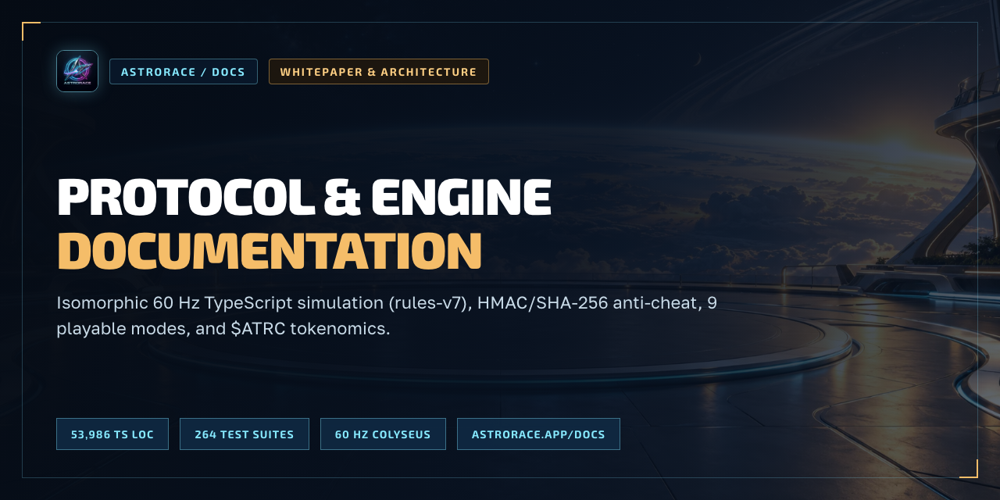
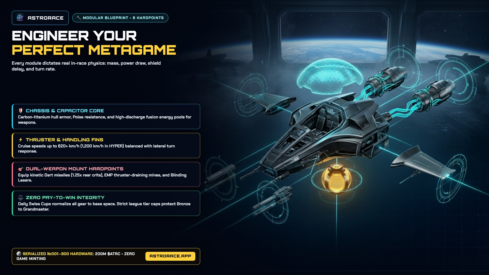
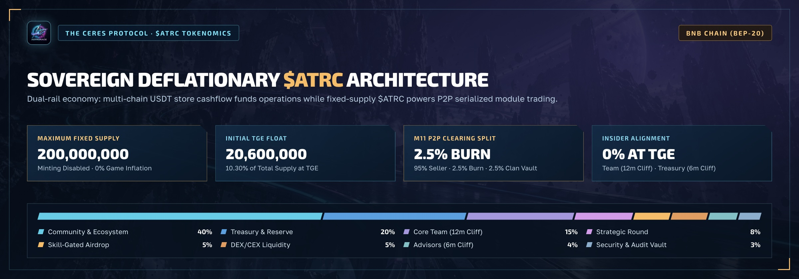

# ASTRORACE Overview

* **Official Website:** [https://astrorace.app](https://astrorace.app)
* **Playable Web Client:** [https://play.astrorace.app](https://play.astrorace.app)
* **Official X (Twitter):** [https://x.com/astroracegame](https://x.com/astroracegame)
* **Official GitHub:** [https://github.com/Astrorace](https://github.com/Astrorace)
* **Headquarters:** Hong Kong

---

## Executive Summary

**ASTRORACE** (*ASTRORACE: Apex Velocity / Hyperdrive*) is a competitive zero-install 3D orbital PvP combat racing game built natively for desktop and mobile web browsers using **WebGPU / WebGL 2.0 (Babylon.js 9.28)** and **deterministic 60 Hz server-authoritative netcode (Colyseus, Fastify, PostgreSQL 18.6)**.

Players launch directly from any browser link into 60 FPS anti-gravity races in under **3.5 seconds** with one-click guest onboarding and zero client downloads. Matches center on high-density **45-second 4-pilot PvP combat sprints** at speeds up to **780 km/h** (**1,200 km/h** inside server-triggered `HYPER` gates), combining curvature-gated plasma drifting, 15-degree slipstream drafting, rear-critical missile locks, EMP mines, and 900 ms `Phase-Drive` invulnerability frames.

---

## Verified Production Engineering Metrics (`rules-v7`)

| Subsystem / Metric | Verified Scope | Technical Baseline |
| :--- | :--- | :--- |
| **TypeScript / TSX Codebase** | **53,986 LOC** across 592 modules | Isomorphic physics, 3D client, REST API, Colyseus rooms |
| **Automated Test Suites** | **264 test suites** | Deterministic simulation, replay verification & ACID ledger tests |
| **Authoritative Simulation Tick** | **60 Hz server / 20 Hz delta / 30 Hz input** | `< 30 kbps` downstream binary delta sync (`80–180 bytes/tick`) |
| **Playable Ship Classes & Modules** | **5 3D hulls · 43 canonical parts** | 6 physical slots × 5 tiers (`T1–T5`) × 5 rarities × `L1–L10` upgrades |
| **Playable Clothoid Circuits** | **8 authoritative tracks** | 4 Circuits + 4 Sprints, Frenet-Serret spline solver, 48 skybox faces |
| **Localization & Audio** | **7 full languages · 12 voiced NPCs** | `en`, `ru`, `es`, `pt-BR`, `fr`, `de`, `zh-CN` (2,071 keys each) |
| **Financial & Inventory Ledger** | **36 PostgreSQL ACID migrations** | Double-entry accounting + `IS_LOCKED` anti-duplication row locks |

---

## Sovereign Dual-Rail Economy (`$ATRC` — The Ceres Protocol)

1. **Rail 1 — Direct Multi-Chain Studio Cashflow (`USDT` on Solana):** Players purchase optional starter bundles, cosmetic liveries, and the 30-day `Dock Prime` pass using major cryptocurrencies (`BTC`, `ETH`, `SOL`, `TON`, `BNB`, `USDT`, `USDC`), settling directly in `USDT` on Solana. Studio operations never rely on selling treasury tokens.
2. **Rail 2 — Deflationary On-Chain `$ATRC` Economy (`200,000,000` Fixed Supply):**
   * **Zero Gameplay Minting:** Races and daily logins never mint `$ATRC`. Minting is permanently disabled at the contract level.
   * **Peer-to-Peer Hardware Trading:** `$ATRC` settles all P2P Module Marketplace trades (`Rare`, `Epic`, `Legendary`, and `Numbered Series №001/300` T3–T5 modules), `Apex Quantum` containers, and High-Stakes Esports Flash Cups.
   * **5.0% Clearing Split:** Every P2P trade routes **95.0%** to the seller, **2.5%** to **permanent token burn**, and **2.5%** to the **Seasonal Syndicate Championship Vault**.
